# CampusDesk — DevOps Capstone

CampusDesk is a campus facility issue tracker. A student finds the AC broken in a lecture hall
or the wifi down in the library, reports it with a building, room, category and priority, and
watches its status change. Maintenance staff filter the backlog, pick issues up, log what they
did, and close them.

This folder takes that application from a laptop to a monitored Kubernetes cluster on AWS:
tests, Docker images, a CI pipeline with a Trivy security gate, Terraform-provisioned EKS, a
Helm chart, Prometheus and Grafana, and three troubleshooting labs.

**Stack:** React + Vite behind nginx · FastAPI · PostgreSQL via SQLAlchemy 2.0 and Alembic ·
Docker · GitHub Actions · Trivy · Terraform · EKS · Helm · Prometheus · Grafana

**Environment:** macOS (Apple Silicon), Docker Desktop, Terraform 1.16.6, AWS `eu-north-1`.

**Walkthrough video (6 min, narrated):**
[Google Drive](https://drive.google.com/file/d/13UvjRd6ZsZSN7Op9oLHVne2TJVaDK4WT/view?usp=sharing)
· a copy is also committed here as [`CampusDesk-Walkthrough.mp4`](CampusDesk-Walkthrough.mp4).

**Screenshots:** the browser shots in `screenshots/` were captured by driving a real Chromium
against the running app with Playwright. The terminal shots are the exact output of the exact
command, typeset into an image — the text is real, only the rendering is automated. Nothing
is mocked or hand-edited.
The EKS cluster was created, deployed to, exercised, and destroyed — see
[M7](#m7--terraform-aws-infrastructure) and [M8](#m8--kubernetes--helm).

---

## Contents

| Module | What it covers |
|---|---|
| [M1](#m1--application) | Application: frontend, backend, database |
| [M2](#m2--testing) | Pytest |
| [M3](#m3--git-and-github) | Git |
| [M4](#m4--docker) | Dockerfiles and Compose |
| [M5](#m5--cicd-pipeline) | GitHub Actions |
| [M6](#m6--devsecops-trivy) | Trivy scanning |
| [M7](#m7--terraform-aws-infrastructure) | Terraform, VPC, EKS |
| [M8](#m8--kubernetes--helm) | Helm, Ingress, HPA |
| [M9](#m9--observability) | Prometheus and Grafana |
| [Bugs found](#bugs-found-and-fixed) | Seven real failures and their fixes |
| [What was not run](#what-was-not-run) | Honest gaps |

---

## Repository layout

```text
session21-devops-capstone-final/
├── frontend/              React + Vite, served by nginx
├── backend/               FastAPI
│   ├── app/               API, models, schemas, metrics, DB config
│   ├── tests/             Pytest
│   └── alembic/           Migrations
├── docker-compose.yml     Full local stack
├── terraform/             AWS VPC + EKS
├── helm/campusdesk/       Kubernetes package
├── k8s/                   Namespace
├── monitoring/            Prometheus values, ServiceMonitor, Grafana dashboard
├── troubleshooting/       Deliberately broken manifests
├── scripts/               Seed helper
├── evidence/              Captured command output from the real runs
└── .github/workflows/     CI/CD
```

---

## Quick start

```bash
docker compose up -d --build
# POSTGRES_PORT=5433 docker compose up -d --build   # if 5432 is taken
./scripts/seed.sh
open http://localhost:3000
```

| URL | What |
|---|---|
| http://localhost:3000 | The dashboard |
| http://localhost:8000/docs | Swagger UI |
| http://localhost:8000/metrics | Prometheus metrics |

---

## M1 — Application

### Data model

Two tables with a foreign key. `issues` holds the report (including the reporter's email, which is
required); `issue_updates` is the worklog staff append while working on it. Two tables rather than one gives a real relationship for Alembic to
migrate, a nested endpoint, and makes average resolution time computable from `created_at` →
`resolved_at`.

### API

```text
GET    /                        service info
GET    /health                  liveness  - deliberately does not touch the DB
GET    /ready                   readiness - does check the DB
GET    /metrics                 Prometheus exposition

GET    /api/issues              list; filter by status/priority/category/building
GET    /api/issues/{id}         one issue, with its worklog
POST   /api/issues              report an issue
PUT    /api/issues/{id}         partial update
DELETE /api/issues/{id}         delete, cascading to the worklog
GET    /api/issues/{id}/updates worklog
POST   /api/issues/{id}/updates add a worklog note
GET    /api/stats               counts by status/priority/building, avg resolution time
```

Eleven endpoints covering GET, POST, PUT and DELETE.

**Why `/health` and `/ready` differ.** `/health` returns without querying anything, so a slow
database cannot get the pod killed and restarted. `/ready` does query, so a pod that cannot
reach Postgres is pulled out of the Service while staying alive.

### Two modes, one page

The dashboard opens in **student mode**: anyone can browse and filter issues and file a new one,
but the Start/Resolve buttons, Delete, and the worklog form are hidden. **Admin mode** is behind
a password (`1234`) and reveals them.

> This is a demo gate, not security. The password is compared in the browser, so anyone can
> bypass it with devtools, and the API accepts the same requests either way. Real protection
> would mean user accounts, a session or token, and role checks on every endpoint — none of
> which the rubric scores, so it was left out deliberately rather than overlooked.

Reporting an issue **requires an email address**, so maintenance can follow up. It is validated
twice: `type="email"` in the browser, and pydantic's `EmailStr` on the server. A missing or
malformed address is rejected with 422.

### Frontend

Sidebar, KPI cards, filter bar, issue table with priority badges and status pills, a detail
panel with the worklog and the reporter's contact address, and a report modal.

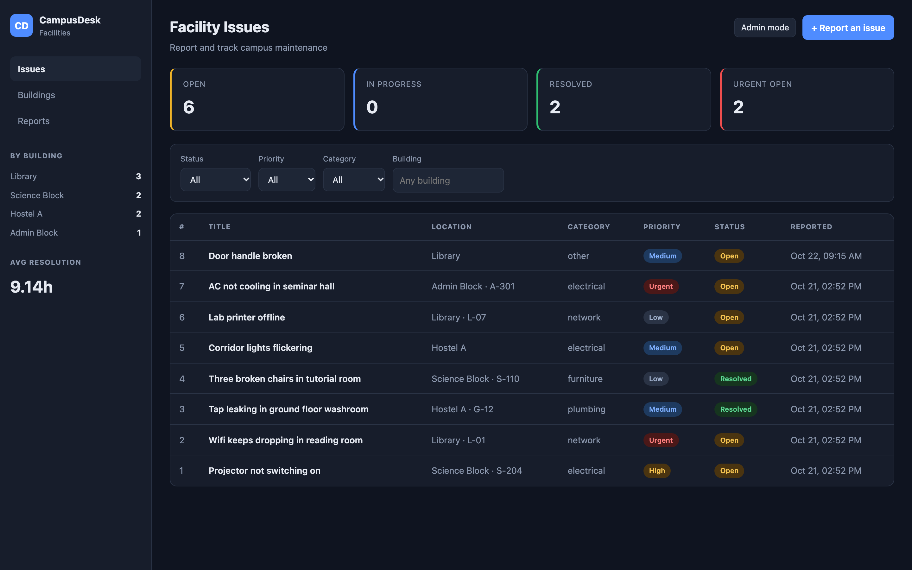

Student mode: browse and filter, file an issue, but no Start/Resolve/Delete column.

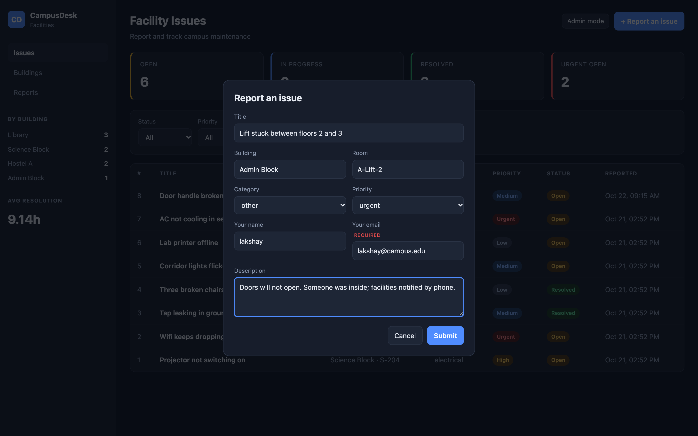

The report form, with the email field marked required.

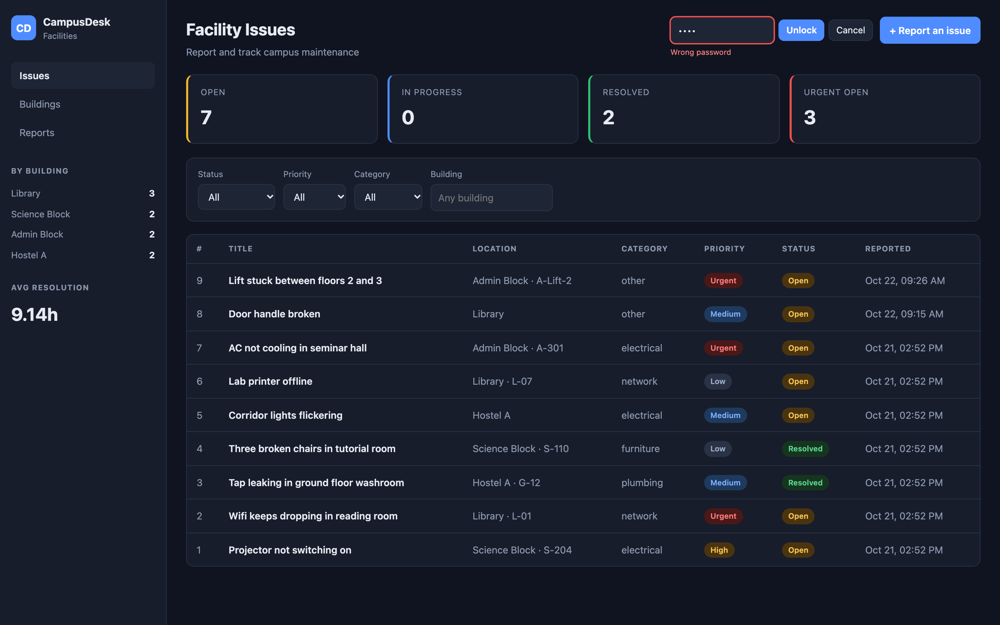

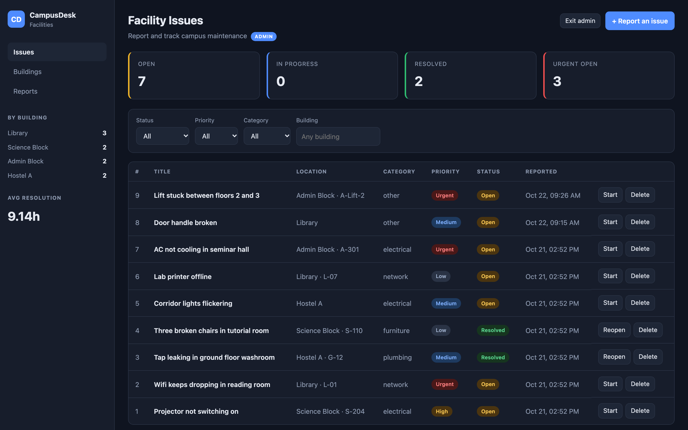

Admin mode unlocked: the `admin` tag appears and the actions column with it.

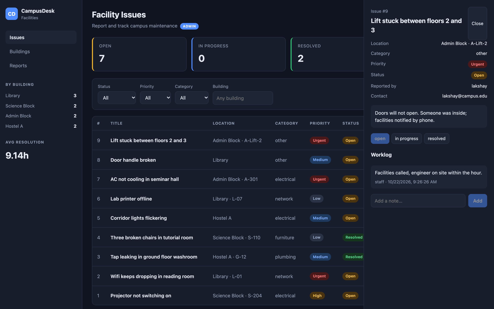

The detail panel, showing the reporter's contact address and a worklog note.

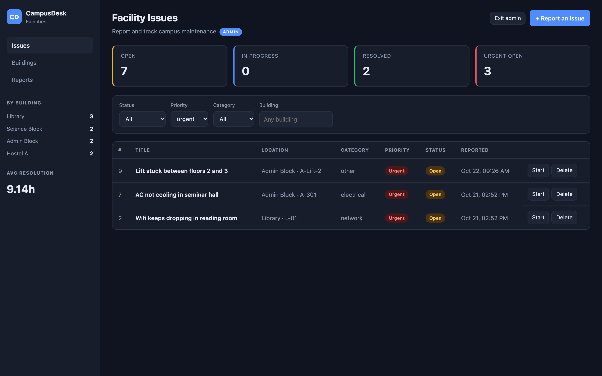

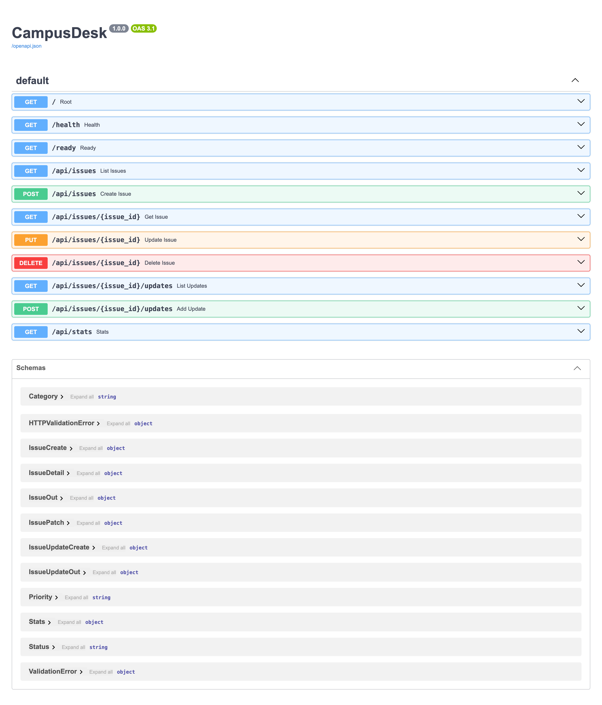

All eleven endpoints, from the generated OpenAPI schema.

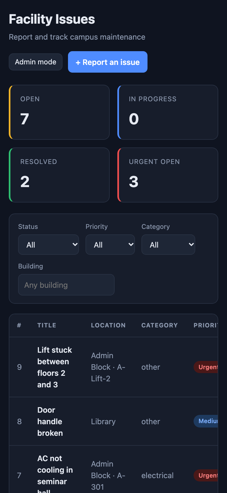

At 414px the sidebar collapses and the KPI cards reflow to two columns. Responsive down to phone width, with loading and
backend-error states. All API calls are relative — nginx and the Ingress handle routing, so no
hostname is ever baked into the bundle.

---

## M2 — Testing

24 tests across every endpoint.

```text
$ pytest
........................                                   [100%]
24 passed, 1 warning in 0.18s
```

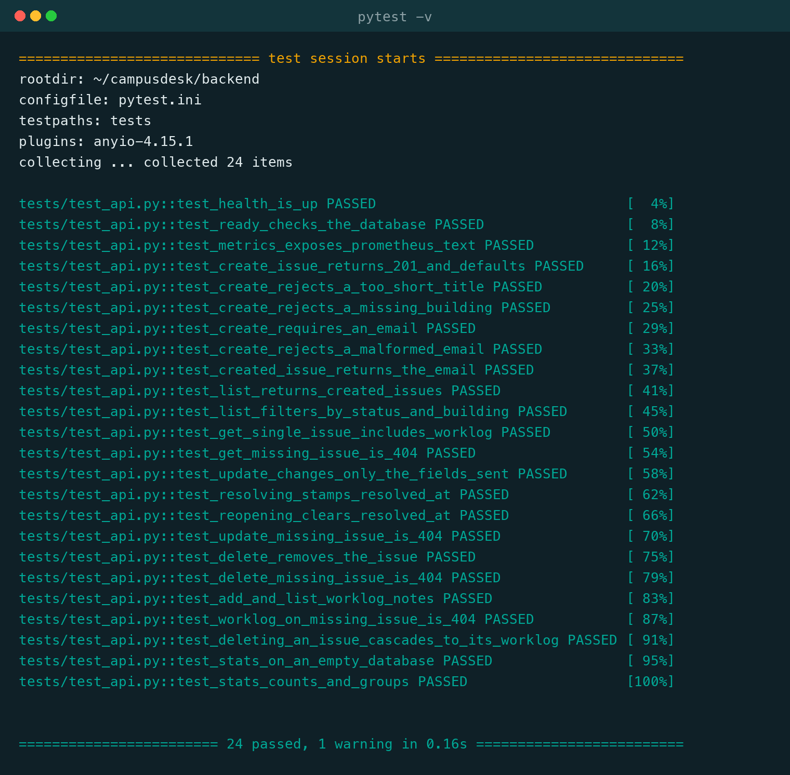

Coverage: probes, create with defaults, validation rejections (422) including a missing and a
malformed reporter email, list, filtering by status
and building, single-issue fetch with worklog, 404s on every path, partial update, the
`resolved_at` stamp being set on resolve and cleared on reopen, delete, cascade delete of the
worklog, and stats on both an empty and a populated database.

Tests never touch the real database. `conftest.py` sets `TESTING=1` and a SQLite URL *before*
any app module is imported, so the startup hook skips `create_all` and the production engine is
never constructed. Each test gets a fresh in-memory database held open with `StaticPool`, and
`PRAGMA foreign_keys=ON` is set per connection — without it SQLite ignores `ON DELETE CASCADE`
and the cascade test would pass for the wrong reason.

---

### Schema changes

`alembic/versions/` holds two migrations. `0002` adds the required `reporter_email` column to a
table that already had rows — it adds the column nullable, backfills it with
`unknown@campus.local`, then applies the NOT NULL constraint. Adding a NOT NULL column directly
fails on any non-empty table, and the seven existing issues were preserved through the upgrade.

## M3 — Git and GitHub

One folder per session in a public repository, this one self-contained. `.gitignore` excludes
`__pycache__/`, `node_modules/`, `.terraform/`, `*.tfstate`, `*.tfvars` (while keeping
`*.tfvars.example`) and `.env`, so neither build output nor credentials are ever committed.

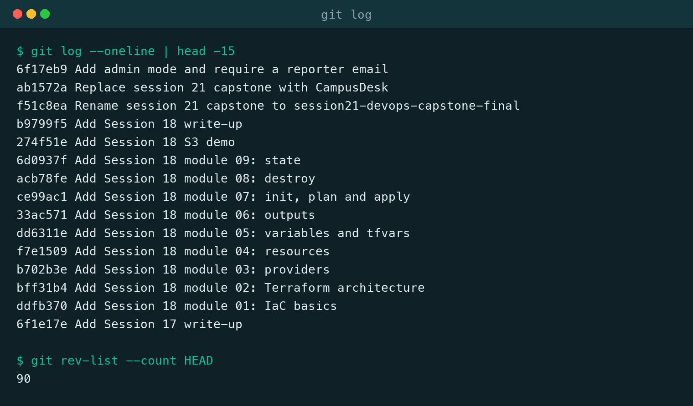

---

## M4 — Docker

Two images, both running unprivileged where the port allows it.

**Backend** — `python:3.13-slim`, OS packages patched, dependencies installed in one layer, pip
removed afterwards (see [bug 4](#4-trivy-reported-cves-that-pip-list-said-were-already-fixed)),
running as UID 10001. Exec-form `CMD` so uvicorn is PID 1 and gets SIGTERM directly.

**Frontend** — multi-stage: Node builds the bundle, `nginx:1.27-alpine` serves it, and nothing
from the build toolchain carries over. `apk upgrade` clears the base image's CVEs. The nginx
config is a template rendered by envsubst at container start, so `BACKEND_URL` is injected
rather than baked in.

**Compose** gates the backend on a real database healthcheck:

```yaml
healthcheck:
  test: ["CMD-SHELL", "pg_isready -U campusdesk -d campusdesk"]
depends_on:
  postgres:
    condition: service_healthy
```

`depends_on` alone waits only for the *container*, not for Postgres to accept connections, and
Alembic then fails on a refused connection.

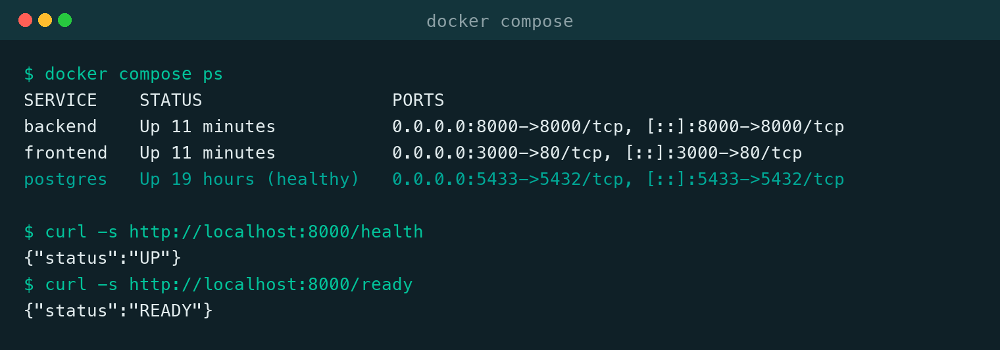

---

## M5 — CI/CD pipeline

The pipeline runs from **`.github/workflows/campusdesk-ci.yml` at the repository root**, not
from this folder. GitHub only discovers workflows in `<repo>/.github/workflows`, so a workflow
nested inside a subdirectory is never triggered. The root copy reaches this folder through
`working-directory` on the script steps and a Docker build `context` on the image steps — the
standard monorepo arrangement — and a `paths:` filter keeps it from firing when unrelated
coursework changes. A copy also sits in this folder's `.github/workflows/` as part of the
module's deliverables.

Three jobs:

1. **test** — pytest (fails the build on any test failure), then the frontend build.
2. **build-scan-push** — matrix over backend and frontend. Each image is built and **loaded
   locally first**, scanned by Trivy, and only pushed to GHCR if the scan passes. Tagged with
   the commit SHA, never `latest`, so every deployment traces to exact source.
3. **deploy** — `helm upgrade --install` against the cluster, skipped cleanly when
   `KUBE_CONFIG_DATA` is not set.

The ordering matters: scanning happens before the push, so a vulnerable image never reaches the
registry at all.

### The pipeline run

[Run #2](https://github.com/lakshay776/DevOpsAssignment/actions/runs/39721769681) — all four
jobs green in 2m 12s.

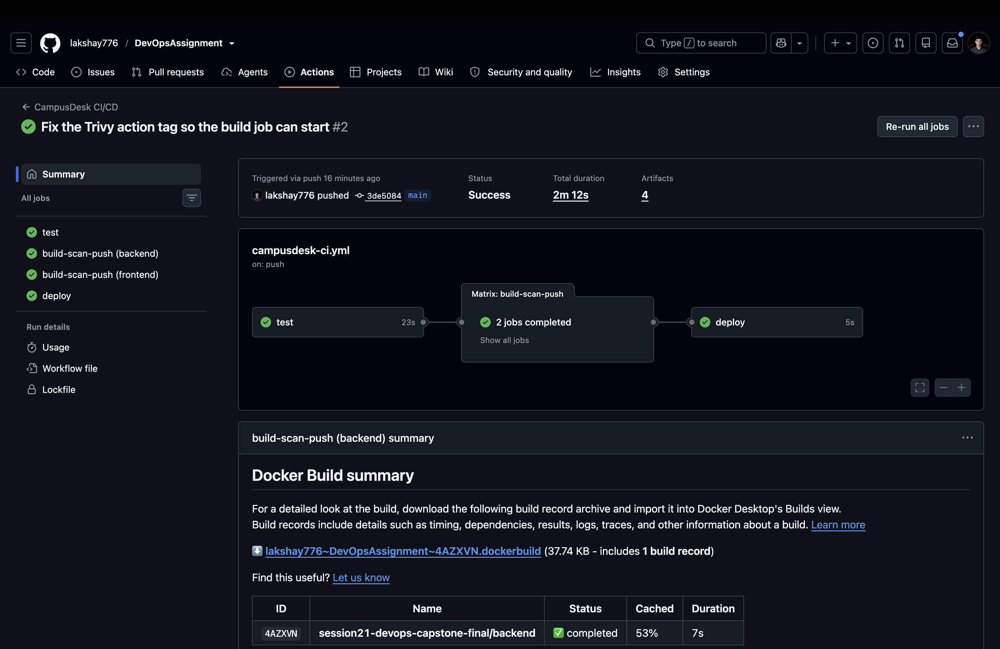

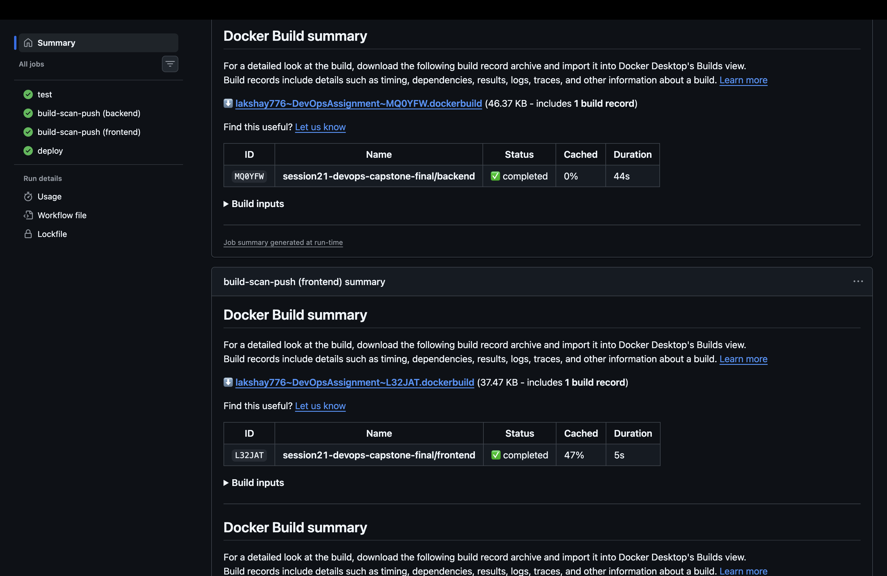

Both images published to GHCR, tagged with the commit SHA rather than `latest`:

```text
ghcr.io/lakshay776/devopsassignment/campusdesk-backend
  tags: ["3de50843775024bb33b11dbf236a29aa1195aad8"]

ghcr.io/lakshay776/devopsassignment/campusdesk-frontend
  tags: ["3de50843775024bb33b11dbf236a29aa1195aad8"]
```

Both are public and anonymously pullable.

The first attempt failed, and the reason is worth recording: both matrix legs died at
`Set up job`, before a single step ran. GitHub resolves every `uses:` reference during setup,
and `aquasecurity/trivy-action@0.28.0` does not exist — that action tags its releases with a
`v` prefix. Pinning `v0.36.0` fixed it. A failure at `Set up job` almost always means a bad
action reference rather than anything wrong with your own steps.

The run also raises deprecation warnings about Node.js 20 in the GitHub-provided actions, and a
notice that `ubuntu-latest` migrates to Ubuntu 26. Both are upstream notices, not failures.

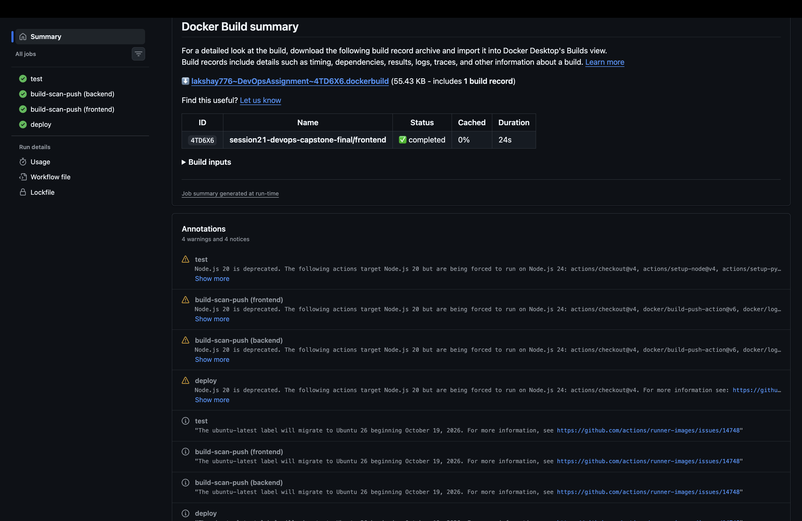

---

## M6 — DevSecOps (Trivy)

The gate is `exit-code: 1` on `HIGH,CRITICAL` — a finding fails the build rather than printing
a report.

| Image | Before | After |
|---|---|---|
| backend | 5 HIGH/CRITICAL | **0** |
| frontend | 17 HIGH/CRITICAL | **0** |

The frontend's 17 were all Alpine OS packages (`curl`, `libcurl`, `libexpat`, `pcre2`, `tiff`),
cleared by rebuilding with a freshly pulled base so `apk upgrade` saw a current index. The
backend's five took real digging — see [bug 4](#4-trivy-reported-cves-that-pip-list-said-were-already-fixed).

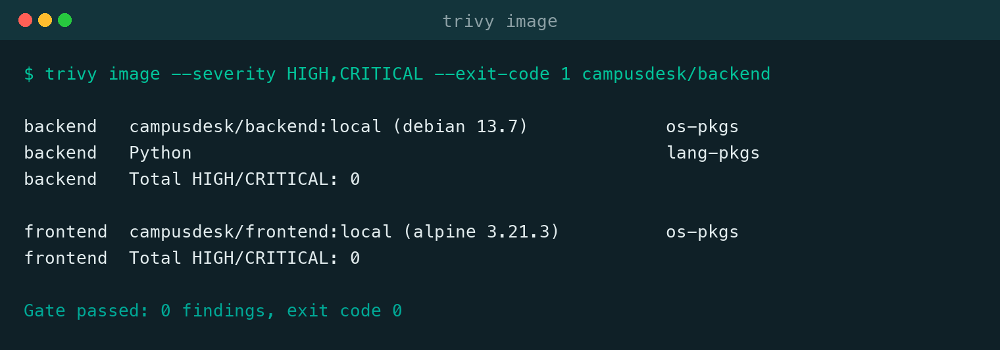

The gate also passed in CI, on base images GitHub's runner pulled fresh — so the clean result
is not an artefact of a warm local cache.

---

## M7 — Terraform (AWS infrastructure)

`terraform/` builds a VPC with an internet gateway, two public subnets in different
availability zones, a route table and associations, two IAM roles with four policy attachments,
an EKS control plane and a managed node group.

Design notes: public subnets with `map_public_ip_on_launch` rather than private subnets behind
a NAT gateway, which would add ~$32/month for no benefit on a cluster that lives for an hour.
`depends_on` the policy attachments, or the cluster can be created before its permissions land.

This was **applied for real**, not just planned:

```text
Apply complete! Resources: 15 added, 0 changed, 0 destroyed.

cluster_endpoint  = "https://1223FE2FB2DA9A58974A452BD0CCDCA4.gr7.eu-north-1.eks.amazonaws.com"
cluster_name      = "campusdesk-eks"
vpc_id            = "vpc-062c859f80be09940"
public_subnet_ids = ["subnet-0bc508ac6f2a170e2", "subnet-06c00fe058b01feb6"]
```

```text
$ kubectl get nodes
NAME                                        STATUS   VERSION
ip-10-0-0-78.eu-north-1.compute.internal    Ready    v1.31.14-eks-b9510e3
ip-10-0-1-93.eu-north-1.compute.internal    Ready    v1.31.14-eks-b9510e3
ip-10-0-1-152.eu-north-1.compute.internal   Ready    v1.31.14-eks-b9510e3
```

And destroyed cleanly afterwards:

```text
Destroy complete! Resources: 15 destroyed.
```

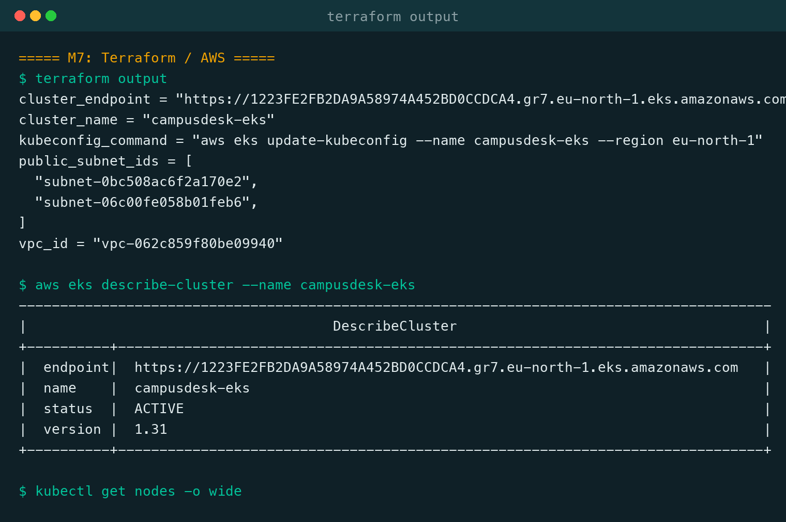

The same resources in the AWS console, region Europe (Stockholm):

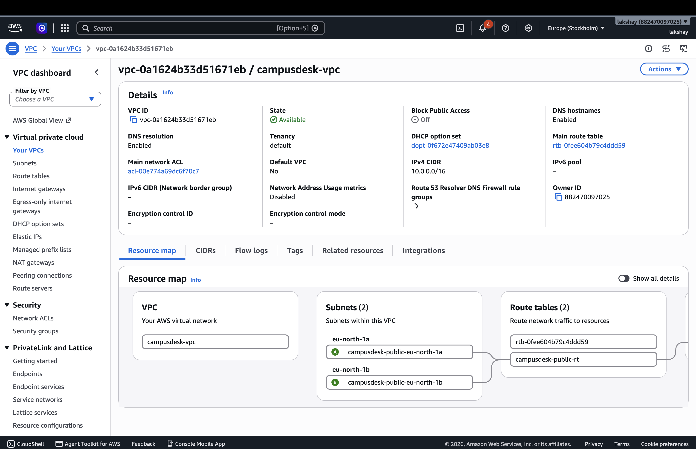

`campusdesk-vpc`, `10.0.0.0/16`, Available — and the resource map showing both public subnets,
one in `eu-north-1a` and one in `eu-north-1b`, behind a shared route table.

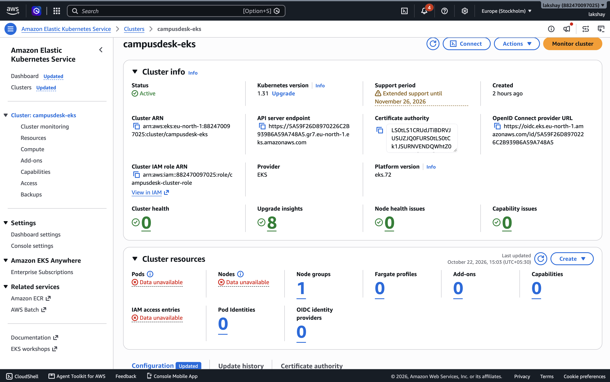

`campusdesk-eks`, Active, Kubernetes 1.31, one managed node group.

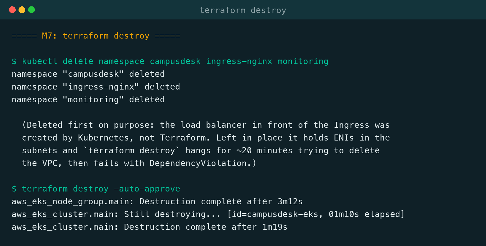

Full output in [`evidence/m7-terraform-eks.txt`](evidence/m7-terraform-eks.txt) and
[`evidence/m7-destroy.txt`](evidence/m7-destroy.txt).

**Order matters on teardown.** The load balancer in front of the Ingress was created by
Kubernetes, not Terraform, so it is not in the state file. Left in place it holds ENIs in the
subnets and `terraform destroy` hangs trying to delete the VPC. Deleting the namespaces first
releases it.

---

## M8 — Kubernetes + Helm

Deployed to the real EKS cluster above. Images were built for `linux/amd64` — the build machine
is Apple Silicon and the nodes are x86_64 — and pushed to ECR.

```text
$ helm upgrade --install campusdesk ./helm/campusdesk -n campusdesk ...
STATUS: deployed
REVISION: 5

$ kubectl get deploy,svc,ingress,hpa -n campusdesk
deployment.apps/campusdesk-backend    2/2   2   2
deployment.apps/campusdesk-frontend   2/2   2   2
service/campusdesk-backend    ClusterIP   172.20.25.75    8000/TCP
service/campusdesk-frontend   ClusterIP   172.20.171.89   80/TCP
service/campusdesk-postgres   ClusterIP   172.20.51.68    5432/TCP
ingress/campusdesk   nginx   *   ada910aa4f48c47eab442f34fc1c17dd-...elb.eu-north-1.amazonaws.com
hpa/campusdesk-backend   Deployment/campusdesk-backend   cpu: 6%/60%   2   6   2
```

The app served real traffic on a public AWS load balancer:

```text
$ curl -s http://ada910aa...elb.eu-north-1.amazonaws.com/ | grep title
<title>CampusDesk</title>

$ curl -s http://ada910aa...elb.eu-north-1.amazonaws.com/api/stats
{"total":7,"open":7,"in_progress":0,"resolved":0,"urgent_open":2,
 "by_building":{"Admin Block":1,"Hostel A":2,"Science Block":2,"Library":2},
 "by_category":{"plumbing":1,"electrical":3,"furniture":1,"network":2}}
```

Chart details worth noting:

- **Alembic runs in an initContainer**, not the main container, so the schema migrates once per
  rollout rather than every replica racing the others.
- **Postgres is a StatefulSet** with `persistence.enabled` gating the PVC — see
  [bug 5](#5-postgres-stuck-pending-on-eks).
- **The HPA targets 60% of the CPU *request***, not the limit. With requests at 50m it scales
  once pods average 30m.

Full output in [`evidence/m8-kubernetes-helm.txt`](evidence/m8-kubernetes-helm.txt).

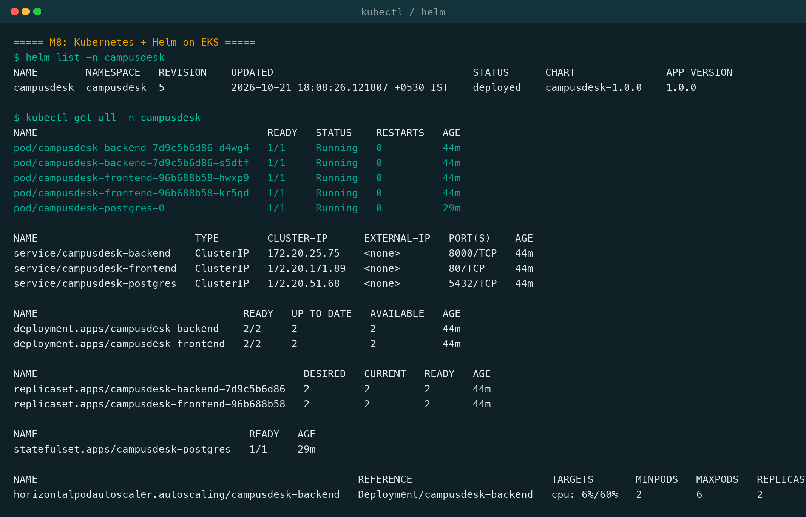

One capture covering `helm list`, `kubectl get all` with every pod `Running`, the three
ClusterIP services, and the HPA reading CPU.

---

## M9 — Observability

The backend exposes standard HTTP metrics through `prometheus-fastapi-instrumentator`, plus
four metrics of its own, because request rate and latency say the service is alive while these
say whether the campus is actually getting fixed:

| Metric | Type | Meaning |
|---|---|---|
| `campusdesk_issues_open{priority}` | gauge | current backlog |
| `campusdesk_issues_created_total{category,priority}` | counter | issues reported |
| `campusdesk_issues_resolved_total{category}` | counter | issues closed |
| `campusdesk_issue_resolution_seconds` | histogram | report → resolution |

The gauge is **recomputed** from the database after every write rather than incremented, since
a gauge must reflect current state. Every priority label is set explicitly including the
zeroes, or a priority that drops to zero keeps its last value forever. The histogram buckets
run from 5 minutes to a week — campus repairs take hours and days, and the default buckets
(topping out at 10s) would put everything in `+Inf`.

Prometheus scraped both backend pods on the live cluster:

```text
pod=campusdesk-backend-7d9c5b6d86-s5dtf  health=up  scrapeUrl=http://10.0.0.67:8000/metrics
pod=campusdesk-backend-7d9c5b6d86-d4wg4  health=up  scrapeUrl=http://10.0.1.52:8000/metrics

query: campusdesk_issues_open   ->  low=2  medium=2  high=1  urgent=2
query: sum(campusdesk_issues_created_total)  ->  7
```

Grafana served a seven-panel dashboard (`monitoring/grafana-dashboard.json`): open issues by
priority, report rate by category, HTTP request rate, p95 latency, and three stat tiles.

Full output in [`evidence/m9-monitoring.txt`](evidence/m9-monitoring.txt).

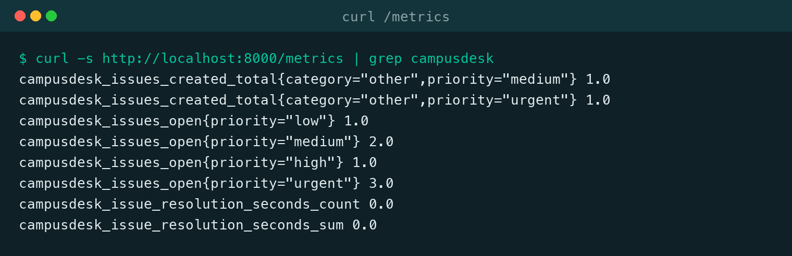

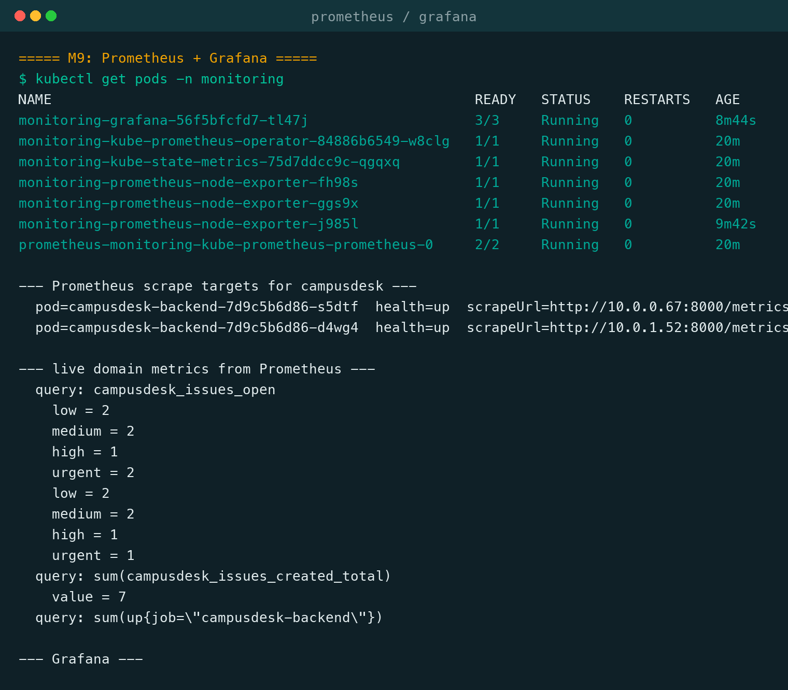

---

## Troubleshooting labs

Three deliberately broken manifests in `troubleshooting/`, each with the symptom and the
diagnosis in its comments:

1. **`01-broken-image.yaml`** — a tag that does not exist. `ErrImagePull` → `ImagePullBackOff`.
   The lesson is in the event order: `Scheduled` succeeds first, so it is not a scheduling
   problem, and `ImagePullBackOff` is the kubelet backing off rather than a separate fault.
2. **`02-bad-service-selector.yaml`** — a selector with a typo. The Service is created happily
   and gets a ClusterIP, so `kubectl get svc` looks fine; the empty `Endpoints` line is the
   tell and requests time out.
3. **`03-failing-readiness.yaml`** — a probe pointed at a path the app does not serve. STATUS
   is `Running` but READY stays `0/1`. Running is not Ready: the container started and the logs
   look healthy, but Kubernetes keeps the pod out of the Service.

---

## Bugs found and fixed

Building this hit six real failures. Each is recorded because the debugging is the point.

### 1. Migration crashed: `type "category" already exists`

The migration created the three Postgres enum types explicitly *and* `op.create_table` created
them again, because a `sa.Enum` column emits its own `CREATE TYPE`. Fixed by referencing them
as `postgresql.ENUM(..., create_type=False)` in the table definition while creating them once
up front with `checkfirst=True`.

### 2. Every write failed: `invalid input value for enum status: "RESOLVED"`

SQLAlchemy persists enum **names** by default (`RESOLVED`), but the migration built the Postgres
type from the **values** (`resolved`). Fixed with
`Enum(Status, values_callable=lambda e: [m.value for m in e])`.

### 3. Frontend Trivy: 17 HIGH/CRITICAL in Alpine packages

`apk upgrade --no-cache` was already in the Dockerfile, but the base image layer was cached from
an earlier build, so the upgrade ran against a stale index. Rebuilding with `--pull --no-cache`
took it to zero.

### 4. Trivy reported CVEs that `pip list` said were already fixed

The stubborn one. Trivy kept flagging `urllib3 2.7.0`, `certifi 2026.6.17`, `msgpack 1.1.2` and
`setuptools 70.3.0` while the image demonstrably contained `2.8.0`, `2026.10.19`, `1.2.3` and
`84.2.1`. Extracting the image tarball and listing layer contents showed only the fixed
versions. Two causes stacked:

- The multi-stage build did `COPY --from=builder /wheels /wheels`, installed, then
  `rm -rf /wheels`. The delete only whites the files out in a *later* layer, so the superseded
  wheels stayed in the image's layer history, which Trivy reads. Fixed by dropping the wheel
  stage and installing directly.
- `pip/_vendor/vendor.txt` **declares** pip's own bundled copies — literally
  `urllib3==2.7.0`, `msgpack==1.1.2`, `setuptools==70.3.0`. Trivy parses that file. Those
  copies are used only by pip and never imported by the app. Fixed by removing pip from the
  runtime image after dependencies are installed, which also takes a package manager out of
  production.

### 5. Postgres stuck `Pending` on EKS

`pod has unbound immediate PersistentVolumeClaims`. EKS 1.31 ships a `gp2` StorageClass that
still points at the **in-tree** `kubernetes.io/aws-ebs` provisioner, which Kubernetes removed in
1.31, so nothing could provision. Installing the EBS CSI driver addon got the node DaemonSet
running but the controller crash-looped on
`no EC2 IMDS role found` — it needs IRSA, which needs an OIDC provider. Since storage is not
part of what this module demonstrates, persistence was made a chart value, defaulting to a PVC
for real clusters and `emptyDir` for this run.

### 6. Ingress returned 404 on every `/api` call

The chart carried `nginx.ingress.kubernetes.io/rewrite-target: /$2`, which strips the `/api`
prefix. That is correct for a backend mounted at `/`, but these FastAPI routes are registered
*at* `/api/...`, so the backend received `/stats` and 404'd. Fixed by removing the rewrite and
using a plain `/api` Prefix path.

Two smaller ones: Grafana crash-looped on
`Only one datasource per organization can be marked as default`, because
kube-prometheus-stack already provisions one and the values file added a second; and Prometheus
would not schedule with `Too many pods`, because a `t3.small` caps at 11 pods per node — the
node group was scaled from 2 to 3.

---

## What was not run

- **The `deploy` job reports success without deploying.** It is guarded on a
  `KUBE_CONFIG_DATA` secret, which is not set, because the EKS cluster it would deploy to was
  destroyed to avoid running costs. The job runs, finds no cluster configured, logs that and
  exits green. Everything before it — pytest, the frontend build, both image builds, both Trivy
  scans and the GHCR push — did real work in
  [run #2](https://github.com/lakshay776/DevOpsAssignment/actions/runs/39721769681).
- **No HPA scale-up under load was demonstrated.** The HPA was deployed and reading CPU
  (`cpu: 6%/60%`), but no load test was run against the cluster before teardown.
- **The AWS load balancer was not created by Terraform.** It was provisioned by the Kubernetes
  Service, so it is outside the state file and had to be removed separately.
